# 电商风险控制系统 · star-tradeGuard

面向电商业务的实时风险控制平台，覆盖 **风险识别 → 规则判断 → 人工复核 → 处置留痕 → 结果查询** 完整闭环。

- **后端**：Python 3.12 + FastAPI + SQLite（标准库 `sqlite3`，零额外依赖）
- **前端**：Vue 3 + Element Plus + ECharts + Vite
- **规则引擎**：25 个风险特征、24 条风险规则，支持与/或嵌套组合与 7 种运算符
- **交付物**：可运行前后端、数据库初始化脚本、示例数据、接口说明、完整演示链路脚本

---

## 界面预览

| 界面 | 截图 |
| --- | --- |
| 系统主页 | 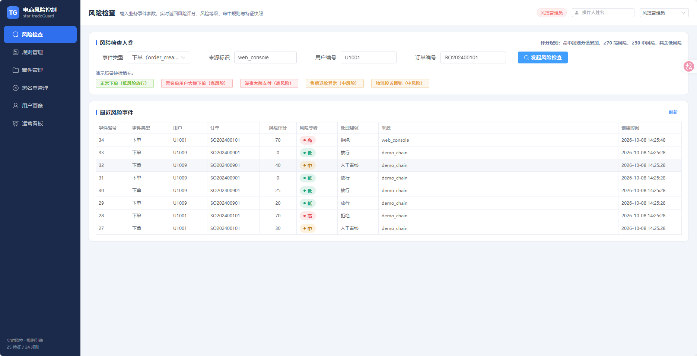 |
| 运营看板 | 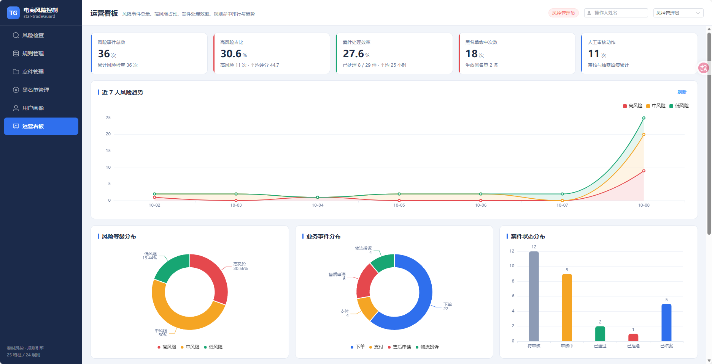 |
| 风险检查 | 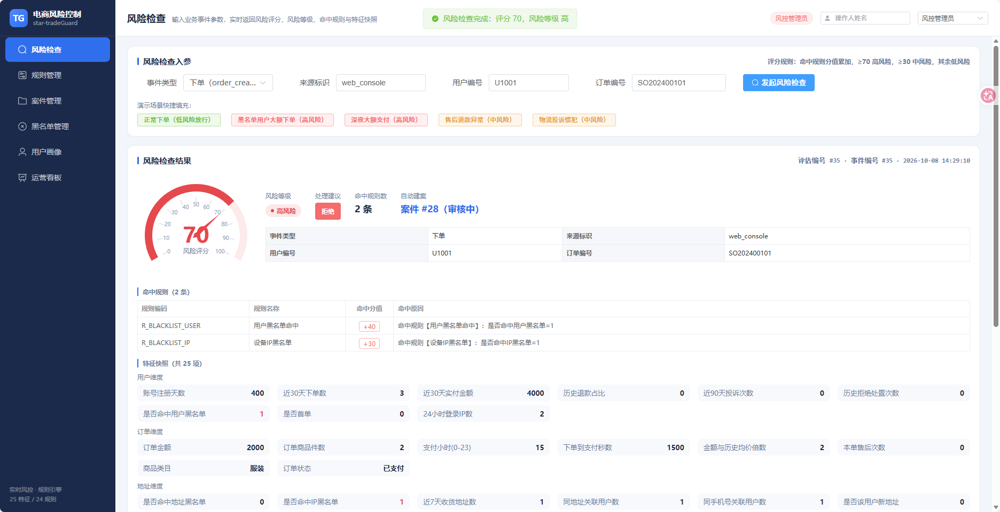 |
| 规则管理 | 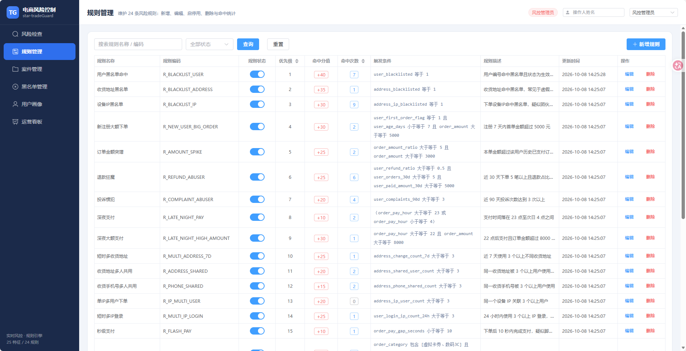 |
| 案件管理 | 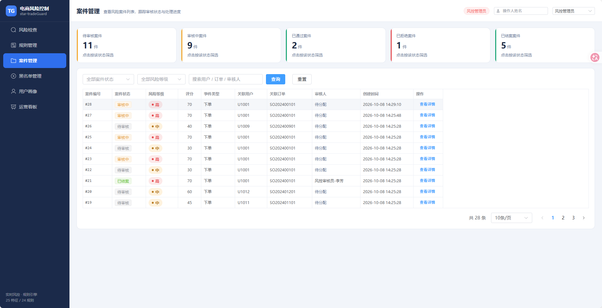 |
| 案件详情 | 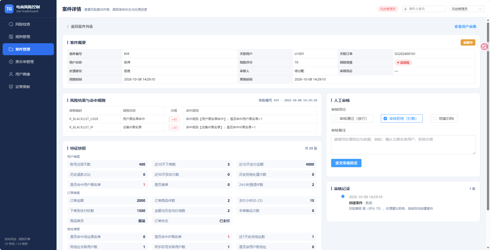 |
| 黑名单管理 | 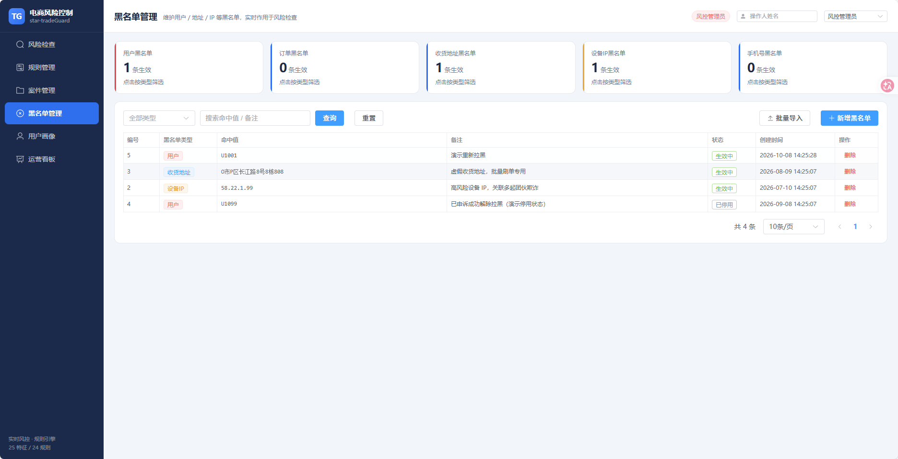 |
| 用户画像 | 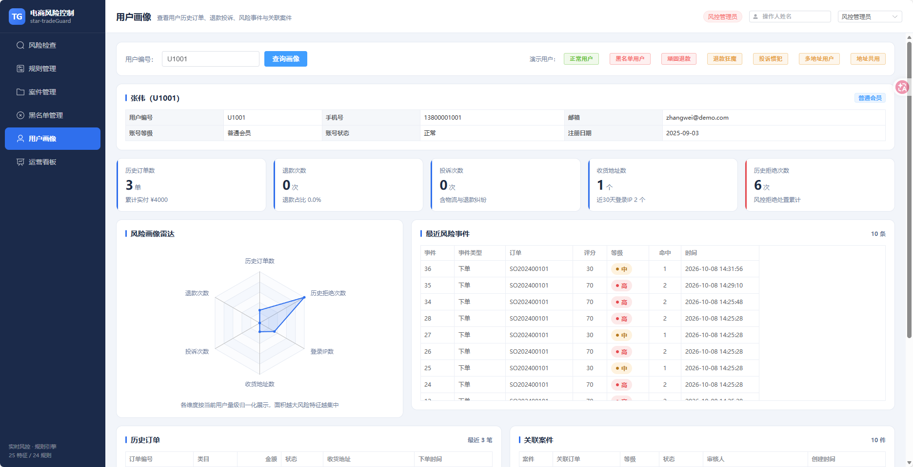 |
| 角色权限切换 | 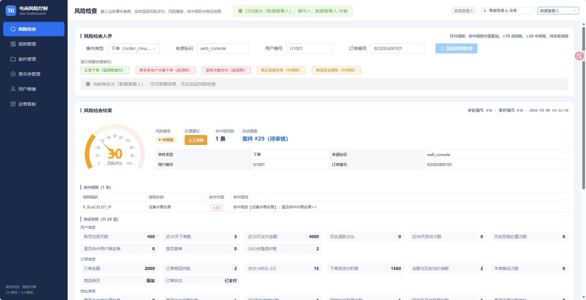 |
| API 页面 | 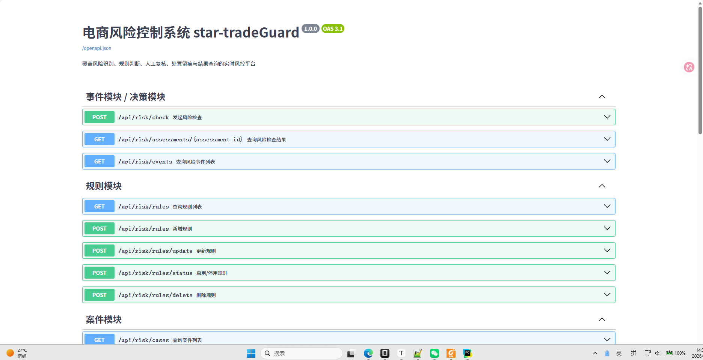 |
| 删除黑名单后复检评分降至 30 | 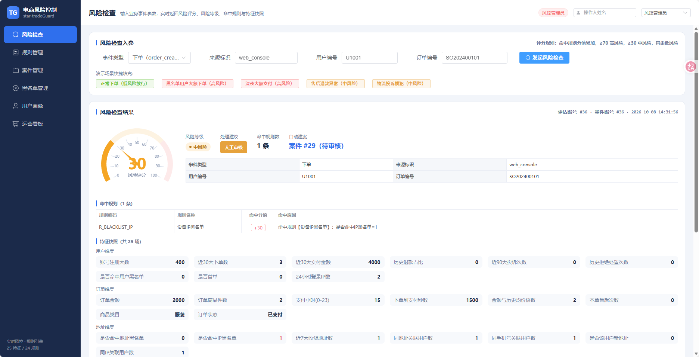 |

---

## 一、快速开始

### 1. 环境准备

```bash
# 依赖安装（后端）
.venv/Scripts/python.exe -m pip install fastapi uvicorn

# 依赖安装（前端，仅首次构建需要；dist 产物已随仓库提供）
cd frontend && npm install && npm run build
```

> **国内网络环境**：若访问官方源缓慢，可使用镜像：
> `-i https://pypi.tuna.tsinghua.edu.cn/simple`（pip）、`--registry=https://registry.npmmirror.com`（npm）。

### 2. 初始化数据库

```bash
.venv/Scripts/python.exe scripts/init_db.py --force
```

输出各表行数，示例：

```
users 12 行 / addresses 16 行 / orders 47 行 / payments 46 行
refunds 15 行 / complaints 9 行 / user_logins 20 行
blacklists 4 行 / risk_rules 24 行
```

### 3. 启动服务

```bash
# 方式一：Windows 一键启动（推荐）
start.bat

# 方式二：手动启动
.venv/Scripts/python.exe -m uvicorn main:app --app-dir backend --host 127.0.0.1 --port 8005
```

- 系统首页：<http://127.0.0.1:8005>
- 接口文档：<http://127.0.0.1:8005/docs>

### 4. 一键验收（推荐先跑）

保持服务运行，另开终端执行：

```bash
.venv/Scripts/python.exe scripts/demo_chain.py
```

脚本使用标准库 `urllib`（零第三方依赖），会对 12 个风险场景 + 8 步完整演示链路
逐条断言并打印 `PASS/FAIL`，末尾输出汇总。**全部通过即代表系统验收合格。**

---

## 二、目录结构

```
star-tradeGuard-system/
├── backend/                    # 后端服务（FastAPI）
│   ├── main.py                 # 应用入口、路由注册、前端静态资源托管
│   ├── config.py               # 路径与评分模型常量（阈值、枚举、中文映射）
│   ├── db.py                   # SQLite 访问层
│   ├── schemas.py              # Pydantic 请求模型
│   ├── features.py             # 特征模块：25 个风险特征计算
│   ├── rules.py                # 规则模块：条件求值引擎 + CRUD 接口
│   ├── decision.py             # 事件模块 + 决策模块：风险检查主链路
│   ├── cases.py                # 案件模块：列表、详情、审核、日志
│   ├── blacklists.py           # 黑名单模块：增删查、批量导入
│   ├── profile.py              # 画像模块：用户画像聚合
│   └── stats.py                # 统计模块：运营看板指标
├── frontend/                   # 前端（Vue 3 + Vite）
│   ├── src/views/              # 7 个页面：检查/规则/案件/案件详情/黑名单/画像/看板
│   ├── src/api/index.js        # 接口封装
│   ├── src/stores/role.js      # 三种角色的权限控制
│   └── dist/                   # 构建产物（运行时无需 Node）
├── sql/
│   ├── schema.sql              # MySQL 8 建表脚本（8 张规范表 + 8 张业务表）
│   └── sample_data.sql         # MySQL 示例数据（与 SQLite 种子口径一致）
├── scripts/
│   ├── init_db.py              # SQLite 建库 + 24 条规则 + 示例数据（幂等，--force 重建）
│   └── demo_chain.py           # 完整演示链路 + 验收断言脚本
├── docs/
│   ├── README.md               # 本文档
│   └── 接口说明.md              # 全部接口的请求/响应/错误码说明
├── data/tradeguard.db          # SQLite 数据库（运行后生成）
├── start.bat                   # 一键启动脚本
└── pyproject.toml
```

---

## 三、页面与角色

| 页面 | 路径 | 功能 |
| --- | --- | --- |
| 风险检查页 | `/check` | 输入事件类型、用户编号、订单编号等参数，返回评分、风险等级、处理建议、命中规则、特征快照（25 项按维度分组渲染） |
| 规则管理页 | `/rules` | 展示规则名称、状态、优先级、命中次数、更新时间；支持新增、编辑、启停用、删除；条件可视化构建（与/或条件组） |
| 案件管理页 | `/cases` | 展示案件编号、状态、风险等级、关联用户、关联订单、审核人、创建时间；支持状态筛选与分页 |
| 案件详情页 | `/cases/:id` | 展示风险结果、命中规则、特征快照、审核记录时间线，并提供人工审核表单 |
| 黑名单页 | `/blacklist` | 展示黑名单类型、命中值、备注、创建时间；支持新增、删除、批量导入 |
| 用户画像页 | `/profile` | 展示历史订单、退款次数、投诉次数、地址数量、最近风险事件、关联案件，含风险画像雷达图 |
| 运营看板页 | `/dashboard` | 展示风险事件总数、高风险占比、案件处理效率、规则命中排行、黑名单命中次数、近 7 天趋势 |

### 三种角色（页面右上角切换）

| 角色 | 权限 |
| --- | --- |
| 风控审核员 `reviewer` | 发起风险检查、查看风险结果、**审核案件、填写处理结论** |
| 风控管理员 `admin` | 全部权限：**维护规则、维护黑名单**、查看统计看板 |
| 数据查看人 `viewer` | 只读：查看用户画像、历史风险记录、命中统计（提交类按钮自动禁用） |

> 演示环境未接入真实登录，角色通过顶部切换器模拟，`operator_id` / `reviewer_id` 记录当前操作人姓名。

---

## 四、完整演示链路

`scripts/demo_chain.py` 覆盖以下闭环，也可在界面上手动操作：

| 步骤 | 操作 | 预期结果 |
| --- | --- | --- |
| 1 | `POST /api/risk/check`（`order_create` / U1001 / SO202400101） | 评分 **70**、等级 **high**、建议 **reject**，命中 `R_BLACKLIST_USER`(40) + `R_BLACKLIST_IP`(30)，**自动建案**（状态 `reviewing`） |
| 2 | `GET /api/risk/assessments/{id}` | 返回 25 项特征快照 + 2 条命中规则及可读命中原因 |
| 3 | 案件管理页 | 可查到该案件 |
| 4 | `GET /api/risk/cases/{id}` | 案件详情含风险结果、命中规则、特征快照、审核日志 |
| 5 | 审核「拒绝」 | 案件状态 → `rejected` |
| 6 | 审核「结案」 | 案件状态 → `resolved`，审核日志累计 3 条（建案/审核/结案） |
| 7 | 删除 U1001 黑名单后复检 | 评分降为 **30**、等级 **medium**、建议 **manual_review**，仅剩 `R_BLACKLIST_IP` |
| 8 | 重新拉黑后复检 | 评分恢复 **70**、等级 **high** |
| 9 | 停用规则 `R_BLACKLIST_USER` 后复检 | 评分降为 **30**（规则立即失效） |
| 10 | 重新启用规则 | 评分恢复 **70**，看板规则命中排行同步变化 |

### 12 个风险场景矩阵（4 类事件 × 12 个用户画像）

| 用户 | 风险模式 | 事件类型 | 期望评分 / 等级 / 建议 |
| --- | --- | --- | --- |
| U1001 | 用户黑名单 + 黑名单 IP | order_create | 70 / high / reject |
| U1002 | 注册 3 天首单 6000 元 + 新地址 | order_create | 55 / medium / manual_review |
| U1003 | 23:40 支付 25000 元 | order_pay | 70 / high / reject |
| U1004 | 新用户首单虚拟卡券 + 8 秒支付 | order_pay | 60 / medium / manual_review |
| U1005 | 退款狂魔（30 天 10 单 7 退） | after_sale_apply | 45 / medium / manual_review |
| U1006 | 顽固退款 + 历史被拒 + 秒付秒退 | after_sale_apply | 80 / high / reject |
| U1007 | 投诉惯犯 + 低活跃 | logistics_complaint | 35 / medium / manual_review |
| U1008 | 投诉 4 次 + 收货地址黑名单 | logistics_complaint | 70 / high / reject |
| U1009 | 正常老用户 300 元日用品 | order_create | 0 / low / pass（**不建案**） |
| U1010 | 近 7 天 3 个地址 + 新地址 6000 元 | order_create | 50 / medium / manual_review |
| U1011 | 24 小时 4 个 IP 登录 + 低活跃大额 | order_create | 45 / medium / manual_review |
| U1012 | 地址/手机号 3 人共用 + 金额突增 | order_create | 60 / medium / manual_review |

---

## 五、风险特征（25 个）

| 维度 | 特征 |
| --- | --- |
| **用户维度（9）** | `user_age_days` 账号注册天数、`user_orders_30d` 近30天下单数、`user_paid_amount_30d` 近30天实付金额、`user_refund_ratio` 历史退款占比、`user_complaints_90d` 近90天投诉次数、`user_rejected_count` 历史拒绝处置次数、`user_blacklisted` 是否命中用户黑名单、`user_first_order_flag` 是否首单、`user_login_ip_count_24h` 24小时登录IP数 |
| **订单维度（8）** | `order_amount` 订单金额、`order_items_count` 商品件数、`order_pay_hour` 支付小时、`order_pay_gap_seconds` 下单到支付秒数、`order_amount_ratio` 金额与历史均价倍数、`order_after_sale_count` 本单售后次数、`order_category` 商品类目、`order_status` 订单状态 |
| **地址维度（7）** | `address_blacklisted` 是否命中地址黑名单、`address_ip_blacklisted` 是否命中IP黑名单、`address_change_count_7d` 近7天收货地址数、`address_shared_user_count` 同地址关联用户数、`address_phone_shared_count` 同手机号关联用户数、`address_is_new_for_user` 是否该用户新地址、`address_ip_user_count` 同IP关联用户数 |
| **事件维度（1）** | `event_type` 业务事件类型 |

> **空值约定**：无法计算的项（如未支付订单的支付特征、无历史订单的金额倍数）返回 `null`，
> 规则引擎中一律判定为**不命中**，避免误伤。
>
> **防自我强化**：`user_rejected_count` 统计历史拒绝次数时**排除当前订单**，
> 避免同一订单被反复检查后评分持续上涨，保证演示结果可重复验证。

---

## 六、风险规则（24 条）

| 优先级 | 规则编码 | 规则名称 | 分值 | 触发条件（摘要） |
| --- | --- | --- | --- | --- |
| 1 | `R_BLACKLIST_USER` | 用户黑名单命中 | 40 | 用户编号命中生效中的用户黑名单 |
| 2 | `R_BLACKLIST_ADDRESS` | 收货地址黑名单 | 35 | 收货地址命中黑名单 |
| 3 | `R_BLACKLIST_IP` | 设备IP黑名单 | 30 | 下单设备 IP 命中黑名单 |
| 4 | `R_NEW_USER_BIG_ORDER` | 新注册大额下单 | 30 | 首单 且 注册 ≤7 天 且 金额 ≥5000 |
| 5 | `R_AMOUNT_SPIKE` | 订单金额突增 | 25 | 金额 ≥历史均价 5 倍 且 金额 ≥3000 |
| 6 | `R_REFUND_ABUSER` | 退款狂魔 | 25 | 退款占比 ≥50% 且 30 天 ≥5 单 且 实付 ≥5000 |
| 7 | `R_COMPLAINT_ABUSER` | 投诉惯犯 | 20 | 近 90 天投诉 ≥3 次 |
| 8 | `R_LATE_NIGHT_PAY` | 深夜支付 | 10 | 支付小时 ≥23 **或** ≤4 |
| 9 | `R_LATE_NIGHT_HIGH_AMOUNT` | 深夜大额支付 | 30 | 支付小时 ≥22 且 金额 ≥8000 |
| 10 | `R_MULTI_ADDRESS_7D` | 短时多收货地址 | 25 | 近 7 天收货地址 ≥3 个 |
| 11 | `R_ADDRESS_SHARED` | 收货地址多人共用 | 20 | 同地址关联用户 ≥3 个 |
| 12 | `R_PHONE_SHARED` | 收货手机号多人共用 | 15 | 同手机号关联用户 ≥3 个 |
| 13 | `R_IP_MULTI_USER` | 单IP多用户下单 | 20 | 同设备 IP 关联用户 ≥3 个 |
| 14 | `R_MULTI_IP_LOGIN` | 短时多IP登录 | 25 | 24 小时登录 IP ≥3 个 |
| 15 | `R_FLASH_PAY` | 秒级支付 | 10 | 下单到支付 ≤10 秒 |
| 16 | `R_VIRTUAL_CATEGORY_BIG` | 高敏类目大额下单 | 20 | 类目属于[虚拟卡券,数码3C] 且 金额 ≥3000 且 件数 ≥3 |
| 17 | `R_ORDER_STATUS_REFUNDED` | 已退款订单再次申请售后 | 5 | 订单状态 = 已退款 |
| 18 | `R_HIGH_RISK_AFTER_SALE` | 高频售后退款用户 | 20 | 事件=售后申请 且 金额 ≥1000 且 退款占比 ≥30% 且 本单售后 ≥1 |
| 19 | `R_COMPLAINT_NEW_USER` | 低活跃用户投诉 | 15 | 事件=物流投诉 且 30 天下单 ≤2 |
| 20 | `R_PRIOR_REJECTED` | 历史被拒用户 | 15 | 历史拒绝处置次数 ≠ 0 |
| 21 | `R_NEW_ADDRESS_HIGH_AMOUNT` | 新收货地址大额下单 | 25 | 新地址 且 金额 ≥6000 |
| 22 | `R_LOW_ACTIVITY_HIGH_AMOUNT` | 低活跃老用户大额下单 | 20 | 30 天下单 ≤1 且 金额 ≥4000 且 注册 >7 天 |
| 23 | `R_AMOUNT_ABNORMAL_HIGH` | 订单金额异常超大 | 30 | 金额 >20000 |
| 24 | `R_AFTER_SALE_QUICK_REFUND` | 秒付秒退 | 15 | 事件=售后申请 且 支付到售后 <300 秒 |

运算符覆盖 `gt` / `gte` / `lt` / `lte` / `eq` / `neq` / `contains` 与 `all`(与) / `any`(或) 条件组，
25 个特征全部被至少一条规则引用。

---

## 七、数据库

### 运行库（SQLite）

`scripts/init_db.py` 负责建库，包含 8 张风控规范表与 8 张业务数据表：

- **风控规范表**：`risk_events`、`risk_assessments`、`feature_snapshots`、`risk_rules`、
  `rule_hits`、`risk_cases`、`blacklists`、`review_logs`
- **业务数据表**：`users`、`user_logins`、`addresses`、`orders`、`payments`、`refunds`、
  `complaints`、`logistics`

### 生产库（MySQL）

```bash
mysql -u root -p < sql/schema.sql
mysql -u root -p tradeguard < sql/sample_data.sql
```

`schema.sql` 使用 MySQL 8 方言（`BIGINT AUTO_INCREMENT` / `DATETIME` / `DECIMAL(12,2)` /
`JSON`），表结构与 SQLite 完全一致；`sample_data.sql` 与 SQLite 种子数据口径一致，
且时间统一基于 `NOW()` 回推，保证 30 天 / 7 天 / 24 小时等特征窗口在任何时间执行都有效。

---

## 八、验收对照

| 验收标准 | 对应实现 | 验证方式 |
| --- | --- | --- |
| 能发起四类业务事件的风险检查 | `POST /api/risk/check`，`event_type` 支持 4 类 | `demo_chain.py` 场景矩阵 |
| 能生成评分、等级、建议、命中规则、特征快照 | `decision.py` 主链路 | 检查页 + `GET /api/risk/assessments/{id}` |
| 高风险结果能自动创建案件 | `score ≥ 30` 自动建案 | 场景矩阵断言 `case_id is not None` |
| 能在案件页完成审核并查看审核日志 | 案件详情页 + `POST /api/risk/cases/review` | 演示链路步骤 4-6 |
| 能新增、编辑、启停用规则并看到命中统计变化 | 规则管理页 + 看板排行 | `demo_chain.py` C 段 |
| 能维护黑名单并在风险检查中生效 | 黑名单页 + 特征实时读取 | 演示链路步骤 7-8 |
| 能查看用户画像和运营看板 | `/profile`、`/dashboard` | 浏览器直接访问 |
| 能完成一条完整演示链路 | — | `scripts/demo_chain.py` 全量断言 |

---

## 九、AI 风险解读层（可选）

规则引擎负责「定性」——25 个特征 + 24 条规则给出评分、风险等级与决策；AI 层只负责「解释」——把命中结果翻译成运营/风控能直接执行的说明。
**评分与决策永远由规则引擎给出，AI 不参与打分，也不改写规则命中项。**

### 1. 能力范围

| 场景 | 位置 | 产出 |
| --- | --- | --- |
| 风险检查 | `POST /api/risk/check` 响应中的 `ai_explanation` | 结论摘要、关键风险点、处置步骤、注意事项 |
| 案件详情 | `GET /api/risk/assessments/{id}` 响应中的 `ai_explanation` | 同上（首次评估时生成并落库，查询不复用不重复消耗 token） |
| 重新解读 | `POST /api/risk/assessments/{id}/ai-explain` | 按需重新调用大模型并覆盖落库结果 |
| 服务状态 | `GET /api/health` → `ai_explainer` | `configured` / `provider` / `model` |

响应字段：`ai_enabled`、`ai_provider`、`ai_model`、`ai_generated_at`、`ai_explanation{summary, key_factors[], handling_steps[], risk_note}`。

### 2. 配置（环境变量，写在 /opt/star/.env）

| 变量 | 默认 | 说明 |
| --- | --- | --- |
| `AI_PROVIDER` | `deepseek` | 目前实现 `deepseek`（OpenAI 兼容协议） |
| `DEEPSEEK_API_KEY` | 空 | 未配置时自动降级为规则模板文案，功能可用、不报错 |
| `DEEPSEEK_BASE_URL` | `https://api.deepseek.com` | 兼容自建 / 代理网关 |
| `DEEPSEEK_MODEL` | `deepseek-flash` | 模型名 |
| `AI_TIMEOUT_SECONDS` | `180` | 单次调用超时（秒） |
| `AI_TEMPERATURE` | `0.2` | 低温度，保证解读口径稳定 |
| `AI_MAX_TOKENS` | `1200` | 输出上限 |
| `AI_REASONING_EFFORT` | `low` | 推理强度 |

改完执行：`cd /opt/star && docker compose up -d --force-recreate trade-guard`。

### 3. 降级与容错

- 未配置 Key / 调用超时 / 返回非法 JSON：自动回退本地规则模板文案，`ai_provider` 标记为 `rule_engine`，页面提示「规则模板（未启用大模型）」，业务链路不中断。
- AI 解读仅作展示与建议，不自动处置、不自动扣款，所有动作仍需人工确认。
- 解读结果随评估落库（`ai_explanation` 表），同一评估重复查询不重复调用大模型。

### 4. 验收

```bash
cd /opt/star && python3 e2e_ai_test.py   # AI 链路端到端（PASS/FAIL 汇总）
python3 e2e_ai_diag.py                   # 逐接口打印真实返回样例，便于人工核对
```

## 十、常见问题

**Q：提示「无法连接后端服务」？**
先确认服务已启动（`start.bat`），访问 <http://127.0.0.1:8005/api/health> 应返回 `{"status":"ok"}`。

**Q：首页显示「前端尚未构建」？**
说明 `frontend/dist` 不存在。执行 `cd frontend && npm install && npm run build` 后重启服务。

**Q：想重置演示数据？**
执行 `.venv/Scripts/python.exe scripts/init_db.py --force` 重建数据库，然后重启服务。

**Q：反复检查同一订单，评分会一直上涨吗？**
不会。`user_rejected_count` 特征在统计时排除了当前订单，避免同单反复检查造成评分自我强化。

**Q：为什么同样的订单检查两次会产生两个案件？**
每次 `POST /api/risk/check` 都是一次独立的风险事件，系统会完整记录事件、评估、快照与命中结果，
并按规则独立建案。这正是风控审计留痕的要求。
